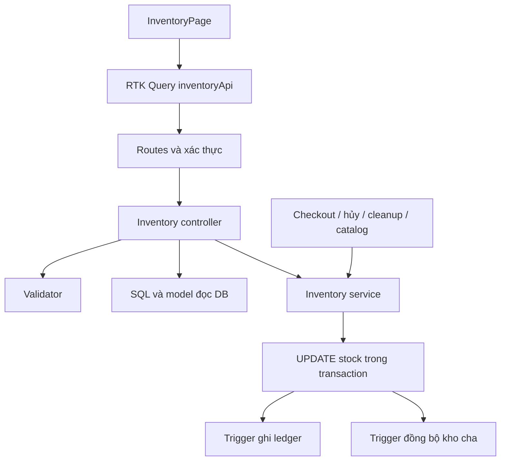
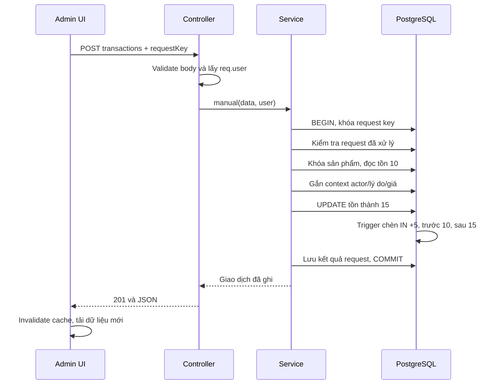

# Inventory: hướng dẫn đọc code, nghiệp vụ và tư duy giải quyết vấn đề

Tài liệu đối chiếu mã nguồn ngày **22/09/2026**. Mục tiêu là giúp bạn hiểu từ thao tác trên màn hình tới thay đổi trong PostgreSQL, biết mỗi file giải quyết vấn đề gì, và biết giới hạn của phiên bản hiện tại.

Đọc cùng [kế hoạch triển khai](INVENTORY_IMPLEMENTATION_PLAN.md) và [biên bản khắc phục database](INVENTORY_DATABASE_REPAIR.md). Tài liệu này giải thích implementation hiện có; phần đề xuất cải tiến không đồng nghĩa đã triển khai.

## Mục lục

1. [Nghiệp vụ và phạm vi](#1-nghiệp-vụ-và-phạm-vi)
2. [Bản đồ các file](#2-bản-đồ-các-file)
3. [Dữ liệu và các quy tắc phải giữ](#3-dữ-liệu-và-các-quy-tắc-phải-giữ)
4. [Luồng nhập hàng từ UI đến DB](#4-luồng-nhập-hàng-từ-ui-đến-db)
5. [Routes và validator](#5-routes-và-validator)
6. [Đọc từng hàm controller](#6-đọc-từng-hàm-controller)
7. [Đọc từng hàm service](#7-đọc-từng-hàm-service)
8. [Transaction, context và trigger](#8-transaction-context-và-trigger)
9. [Đặt hàng, hủy, hết hạn, thanh toán và trả hàng](#9-đặt-hàng-hủy-hết-hạn-thanh-toán-và-trả-hàng)
10. [Catalog và định danh biến thể](#10-catalog-và-định-danh-biến-thể)
11. [Frontend](#11-frontend)
12. [Migration, vận hành và sự cố](#12-migration-vận-hành-và-sự-cố)
13. [Kiểm thử và cách kiểm chứng](#13-kiểm-thử-và-cách-kiểm-chứng)
14. [Giới hạn và các việc cần hoàn thiện](#14-giới-hạn-và-các-việc-cần-hoàn-thiện)
15. [Thứ tự học code và giải thích khi phỏng vấn](#15-thứ-tự-học-code-và-giải-thích-khi-phỏng-vấn)

## 1. Nghiệp vụ và phạm vi

### 1.1 Vấn đề ban đầu

Một cột `stockQuantity = 8` cho biết số lượng hiện tại, nhưng không trả lời được:

- Ai đã thay đổi số lượng?
- Tại sao từ 10 còn 8: bán hàng, hỏng hay kiểm kê?
- Nhập hàng lúc nào, giá mua mỗi chiếc bao nhiêu?
- Đơn hàng nào làm phát sinh việc trừ hoặc hoàn kho?

Giải pháp giữ **số dư hiện tại** để đọc nhanh, đồng thời ghi **sổ biến động** để truy vết. Không tính lại toàn bộ lịch sử mỗi lần khách xem sản phẩm.

### 1.2 Đây là kho khả dụng

`stockQuantity` hiện thể hiện **số lượng còn có thể bán theo cơ chế đặt hàng hiện tại**. Khi tạo đơn pending, hệ thống trừ ngay; chưa cần đợi thanh toán hoặc hàng rời kho.

Ví dụ có 10 chiếc, khách đặt 2 chiếc: khả dụng còn 8, nhưng 10 chiếc có thể vẫn nằm trong kho vật lý. Hủy đơn sẽ trả khả dụng về 10.

Chưa có các cột riêng `on_hand` và `reserved`. Vì vậy `OUT` trong báo cáo là trừ theo đơn, không phải chứng từ xác nhận xuất vật lý.

### 1.3 Các loại giao dịch

| Loại | Dấu số lượng | Khi nào phát sinh? | Nguồn chính |
|---|---|---|---|
| `OPENING` | >= 0 | Số dư khi bật audit hoặc tạo hàng hóa mới | Migration / catalog |
| `IN` | > 0 | Nhập hàng, có đơn giá nhập | Admin |
| `OUT` | < 0 | Tạo đơn hàng | Checkout |
| `RELEASE` | > 0 | Hoàn lượng đã trừ do hủy/hết hạn | Khách, Admin, job |
| `RETURN` | > 0 | Nhận lại hàng từ đơn delivered | Admin |
| `ADJUSTMENT` | Khác 0 | Kiểm kê, thất thoát, hư hỏng, điều chỉnh tăng | Admin |

API thao tác thủ công chỉ nhận `IN`, `ADJUSTMENT`, `RETURN`. Không cho frontend tự gửi `OUT` hoặc `RELEASE` để bỏ qua nghiệp vụ đơn hàng.

### 1.4 Đơn giá nhập và giá bán

Nhập 10 chiếc, đơn giá 200.000 VND/chiếc: tiền hàng nhập là 2.000.000 VND. Giá bán có thể là 300.000 VND/chiếc.

- `inventory_transactions.unit_cost`: giá mua một đơn vị trong giao dịch đó.
- `products.price` / `product_variants.price`: giá bán, không tự đổi theo giá nhập.
- Lần nhập sau có thể có đơn giá khác; lịch sử lần trước không bị sửa.
- Chưa tính giá vốn FIFO/bình quân, phân bổ vận chuyển/thuế hoặc lợi nhuận. Không suy diễn giá vốn cho `OPENING` cũ.

### 1.5 Chọn đúng đơn vị quản lý

Sản phẩm đơn quản lý tại `products`. Sản phẩm có biến thể quản lý từng `product_variants.id`; sản phẩm cha chỉ giữ tổng để hiển thị.

Ví dụ Áo/Đỏ còn 2, Áo/Xanh còn 100: biến thể Đỏ phải báo tồn thấp dù tổng cha là 102. Một lần nhập biến thể chỉ ghi một dòng ledger, không thêm một dòng nhập tương đương cho cha.

## 2. Bản đồ các file

Các đường dẫn dưới đây tương đối từ tài liệu, có thể bấm để mở code.

| File | Trách nhiệm liên quan Inventory |
|---|---|
| [inventory.routes.js](../be/src/routes/inventory.routes.js) | Đăng ký 4 API và middleware Admin |
| [routes/index.js](../be/src/routes/index.js) | Gắn router vào `/admin/inventory` |
| [app.js](../be/src/app.js) | Gắn nhóm route dưới `/api` |
| [inventory.validator.js](../be/src/validators/inventory.validator.js) | Kiểu dữ liệu, giới hạn, quy tắc payload |
| [inventory.controller.js](../be/src/controllers/inventory.controller.js) | Nhận request, truy vấn đọc, gọi service, trả JSON |
| [inventory.service.js](../be/src/services/inventory.service.js) | Khóa, idempotency, nghiệp vụ thay đổi kho và đơn hàng |
| [inventoryTransaction.js](../be/src/models/inventoryTransaction.js) | Model đọc bảng lịch sử; không phải nơi tự tạo bảng |
| [migration inventory](../be/src/migrations/20260921090000-inventory-ledger.js) | Bảng, ràng buộc, số dư đầu kỳ, trigger audit |
| [migration stock sync](../be/src/migrations/20260330103652-add-stock-sync-trigger.js) | Trigger đồng bộ tổng kho cha từ variants |
| [transactionContext.js](../be/src/config/transactionContext.js) | Context bất đồng bộ trong Node để truyền transaction ngầm |
| [sequelize.js](../be/src/config/sequelize.js) | Kết nối Sequelize và bật CLS context |
| [database.js](../be/src/config/database.js) | Cấu hình DB theo môi trường, naming underscored |
| [adminAuth.js](../be/src/middlewares/adminAuth.js) | Xác thực token, quyền admin/manager, đặt `req.user` |
| [catchAsync.js](../be/src/shared/utils/catchAsync.js) | Đưa lỗi promise vào `next(error)` |
| [errorHandler.js](../be/src/middlewares/errorHandler.js) | `AppError`, trả lỗi HTTP |
| [order.controller.js](../be/src/controllers/order.controller.js) | Checkout OUT, khách hủy, Admin chuyển trạng thái, thanh toán lại |
| [orderCleanup.job.js](../be/src/jobs/orderCleanup.job.js) | Hết hạn đơn, RELEASE và hoàn lượt coupon |
| [payment.controller.js](../be/src/controllers/payment.controller.js) | Ngăn thanh toán muộn mở lại đơn đã hoàn kho |
| [admin.controller.js](../be/src/controllers/admin.controller.js) | Bao transaction catalog, sửa biến thể, dùng chuyển trạng thái chung |
| [product.controller.js](../be/src/controllers/product.controller.js) | Đường API sản phẩm khác cũng phải tuân thủ kho |
| [productVariant.js](../be/src/models/productVariant.js) | Model và hook giá/tổng kho đã có; service kho tránh chạy hook lặp |
| [product.js](../be/src/models/product.js) | Số dư sản phẩm, mode biến thể, trạng thái |
| [order.js](../be/src/models/order.js), [orderItem.js](../be/src/models/orderItem.js) | Chứng từ tham chiếu cho OUT/RELEASE/RETURN |
| [coupon.service.js](../be/src/services/coupon.service.js) | Hoàn lượt dùng coupon cùng transaction hủy/hết hạn |
| [server.js](../be/src/server.js) | Khởi động DB và job; schema thay đổi qua migration |
| [inventoryApi.ts](../fe/src/services/inventoryApi.ts) | Kiểu dữ liệu, RTK Query, cache tags |
| [InventoryPage.tsx](../fe/src/pages/admin/InventoryPage.tsx) | Form nhập/điều chỉnh/trả, bảng, bộ lọc, biểu đồ |
| [api.ts](../fe/src/services/api.ts) | API client chung và tag `Inventory` |
| [AppRoutes.tsx](../fe/src/routes/AppRoutes.tsx), [AdminLayout.tsx](../fe/src/components/admin/AdminLayout.tsx) | Route `/admin/inventory`, menu Tồn kho |
| [ProductsPage.tsx](../fe/src/pages/admin/ProductsPage.tsx) | Màu cảnh báo khi stock <= 5 trên danh sách sản phẩm |
| [EditProductPage.tsx](../fe/src/pages/admin/EditProductPage.tsx) | Hướng người dùng chỉnh số lượng qua Inventory |
| [ProductPricingForm.tsx](../fe/src/components/product/ProductPricingForm.tsx), [VariantModal.tsx](../fe/src/components/modals/VariantModal.tsx) | Prop `stockReadOnly` khóa nhập số tồn khi sửa catalog |
| [inventory.integration.cjs](../be/test/inventory.integration.cjs) | Kiểm thử bằng DB tạm, không phải runtime ứng dụng |
| [repair-product-unique-indexes.sql](../be/scripts/repair-product-unique-indexes.sql) | Công cụ sửa index trùng, không chạy mỗi request |

`inventory-edit.cjs` từng là script tạm để thay code nhiều file; đã xóa sau khi dùng. Không phải migration, service hay test cần cho ứng dụng chạy.

Kiến trúc **hiện tại**:



Chưa có `inventory.repository.js`. Query đọc đang ở controller; tách repository là hướng cải tiến, không phải mô tả code đã làm.

## 3. Dữ liệu và các quy tắc phải giữ

### 3.1 Bảng ledger

| Cột DB | Ý nghĩa |
|---|---|
| `id` | ID giao dịch |
| `product_id`, `variant_id` | Hàng hóa; variant null khi là sản phẩm đơn |
| `type` | Loại nghiệp vụ |
| `quantity_change` | Chênh lệch có dấu |
| `previous_stock`, `new_stock` | Số trước/sau từ OLD/NEW của DB |
| `created_by` | UUID người thực hiện; null cho hệ thống |
| `actor_name` | Snapshot tên/email người thực hiện |
| `source`, `reason` | Nguồn CHECKOUT/ORDER/ADMIN/CATALOG/MIGRATION và lý do |
| `unit_cost`, `currency` | Đơn giá nhập DECIMAL và VND |
| `order_id`, `order_item_id` | Đơn và dòng hàng liên quan |
| `sku`, `product_name` | Snapshot tại thời điểm phát sinh |
| `request_key` | Liên kết yêu cầu thủ công để xử lý retry |
| `created_at` | Thời điểm ghi DB |

Model dùng camelCase, cấu hình underscored ánh xạ tới snake_case. Ví dụ `quantityChange` tương ứng `quantity_change`. Model `timestamps: false` vì bảng chỉ có `created_at`, không có `updated_at`.

`created_by` hiện không khai báo FK users; snapshot actor vẫn còn khi user bị xóa. Ngược lại product, variant, order, order item có FK RESTRICT để giữ chứng từ đã được tham chiếu.

### 3.2 Bảng chống xử lý lặp

`inventory_requests` lưu `request_key` làm khóa chính, `fingerprint` nội dung, `result` JSONB và thời điểm. Đây là nhật ký xử lý request, khác ledger nghiệp vụ.

### 3.3 Bất biến

```text
new_stock = previous_stock + quantity_change
previous_stock >= 0
new_stock >= 0
Tổng quantity_change của một đơn vị kho = stock hiện tại
```

Công thức tổng đã bao gồm OPENING; không cộng số dư đầu kỳ thêm lần nữa nếu đã SUM mọi loại giao dịch. Sản phẩm cha có variants đối chiếu tổng các variant, không đối chiếu ledger cha vốn không ghi trùng.

Ví dụ ledger: OPENING +10, IN +5, OUT -2, ADJUSTMENT -1 → tồn 12.

DB kiểm tra dấu phù hợp từng loại; IN bắt buộc unit_cost. Lịch sử bị chặn UPDATE/DELETE/TRUNCATE bởi trigger. Muốn sửa sai phải thêm điều chỉnh, không sửa dòng cũ. Hiện chưa có trường liên kết giao dịch đảo chính thức, cần ghi lý do rõ ràng.

## 4. Luồng nhập hàng từ UI đến DB

Ví dụ Admin nhập 5 chiếc, giá 200.000 VND/chiếc vào một sản phẩm đang còn 10.



Nếu trigger không ghi được lịch sử, câu UPDATE và transaction thất bại. Nếu DB đã commit nhưng mạng mất response, thử lại cùng requestKey lấy kết quả cũ mà không cộng thêm 5.

## 5. Routes và validator

### 5.1 API

Tiền tố đầy đủ: `/api/admin/inventory`. Router gọi `adminAuthenticate` trước bốn handler.

| Method/path | Controller | Nội dung |
|---|---|---|
| GET `/stock` | `getStock` | Hàng hóa và số tồn, phân trang |
| GET `/transactions` | `getTransactions` | Lịch sử |
| GET `/stats` | `getStats` | Tổng theo ngày |
| POST `/transactions` | `createTransaction` | IN/ADJUSTMENT/RETURN |

Middleware kiểm tra JWT, user, vai trò admin/manager và email xác thực. Frontend không được tự chỉ định actor. Backend lấy từ `req.user`.

### 5.2 Query schema

- page: số nguyên 1–100.000, mặc định 1.
- limit: 1–100, mặc định 20.
- search: tối đa 100 ký tự, được phép rỗng.
- lowStock: boolean, mặc định false.
- productId/variantId: UUID v4/v5.
- type: một trong 6 loại ledger.
- from/to: ngày ISO; to được so sánh với from trong schema hiện tại.

Hàm validate trả `result.value`, giữ kết quả chuyển kiểu của Joi: URL `page=2` từ chuỗi thành số, `lowStock=true` thành boolean, ngày thành Date. Đây là lý do không chỉ validate rồi tiếp tục dùng nguyên req.query.

Không phải endpoint nào cũng dùng mọi field của schema chung: stock dùng search/lowStock/page/limit; history dùng productId/variantId/type/search/ngày/page/limit; stats dùng ngày và productId. Gửi variantId cho stats hiện không lọc theo variant.

### 5.3 Payload thủ công

```json
{
  "productId": "123e4567-e89b-42d3-a456-426614174000",
  "type": "IN",
  "quantityChange": 5,
  "unitCost": 200000,
  "reason": "Nhập theo phiếu NK-001",
  "requestKey": "receipt-demo-001"
}
```

UUID ví dụ phải thay bằng ID thực khi gọi API.

| Quy tắc | Lý do |
|---|---|
| quantityChange nguyên, khác 0 | Kho đếm đơn vị; giao dịch 0 không có ý nghĩa |
| IN/RETURN dương | Nhập/nhận trả làm tăng kho |
| ADJUSTMENT có thể âm | Hỏng/thất thoát làm giảm kho |
| IN có unitCost >= 0 | Ghi giá nhập; 0 được phép |
| RETURN có orderItemId | Đối chiếu hàng đã bán và số đã trả |
| Các loại khác không nhận orderItemId | Không gắn chứng từ sai nghiệp vụ |
| Chỉ IN nhận unitCost | Không trộn giá nhập với nghiệp vụ khác |
| reason 3–1.000 ký tự, trim | Có lý do truy vết |
| requestKey 8–120 ký tự theo pattern | Nhận diện retry |

Ví dụ hỏng 2 chiếc: type ADJUSTMENT, quantityChange -2, reason mô tả hỏng; không gửi unitCost. Không gửi số tồn đích 8 thay cho chênh lệch -2.

## 6. Đọc từng hàm controller

### 6.1 getStock

Controller tạo CTE `WITH stock AS (...)`: kết quả trung gian trong một truy vấn, không tạo bảng vật lý.

1. SELECT sản phẩm đơn; variantId là `NULL::uuid`.
2. UNION ALL SELECT từng biến thể, JOIN cha để lấy tên/trạng thái.
3. Lọc tên hoặc SKU bằng ILIKE; `%từ khóa%` tìm chuỗi chứa từ khóa.
4. `:low = false OR stockQuantity <= 5` bật/tắt lọc tồn thấp.
5. Lấy trang dữ liệu và một query đếm/tổng chạy bằng Promise.all.

| Cú pháp | Cách đọc |
|---|---|
| `p`, `v` | Alias sản phẩm, biến thể |
| `AS "productId"` | Tên cột trả về camelCase |
| `COALESCE(sku,'')` | SKU null trở thành chuỗi rỗng |
| `p.name || ' / ' || v.name` | Ghép tên cha và biến thể |
| `UNION ALL` | Nối dòng hai SELECT theo vị trí cột |
| `LIMIT / OFFSET` | Giới hạn và bỏ qua dòng để phân trang |
| `COUNT(*) FILTER (...)` | Đếm riêng các dòng đúng điều kiện |
| `::int`, `::bigint` | Ép kiểu PostgreSQL |

Query thứ nhất trả rows trang hiện tại, có cờ lowStock; sắp xếp số tồn tăng dần rồi ID. Query thứ hai trả total, lowStock, units trên **toàn bộ bộ lọc**, không chỉ trang hiện tại.

`replacements` truyền search/low/limit/offset qua Sequelize thay vì nối trực tiếp giá trị người dùng vào SQL. Các ký tự wildcard `%` và `_` trong search vẫn mang nghĩa tìm kiếm SQL.

`...counts[0]` trải các tổng vào response. Hai query độc lập không cùng snapshot transaction, nên nếu có ghi kho đồng thời, danh sách và tổng có thể lệch tạm thời. Chưa có tính nhất quán snapshot cho màn hình đọc.

### 6.2 historyWhere và getTransactions

historyWhere chỉ dựng object filter, không truy vấn DB:

```js
where.productId = q.productId; // nếu có
where[Op.or] = [/* SKU hoặc tên chứa từ khóa */];
where.createdAt = { [Op.gte]: q.from, [Op.lte]: q.to };
```

Trong code thật, chỉ thêm từng mốc ngày khi được truyền. `Op.gte` là >=, `Op.lte` là <=, `Op.iLike` là tìm kiếm không phân biệt hoa/thường.

`Inventory.findAndCountAll()` trả rows và count. Sắp xếp createdAt DESC, id DESC để mới nhất trước và có thứ tự khi trùng thời điểm. Đây là ORM đọc ledger, không đụng số tồn.

### 6.3 getStats

Mặc định lấy từ hiện tại trừ 30 ngày đến hiện tại; từ chối khoảng đảo ngược hoặc dài hơn 366 ngày. `86400000` là mili giây trong một ngày.

SQL chuyển thời điểm sang `Asia/Ho_Chi_Minh`, định dạng YYYY-MM-DD, rồi GROUP BY ngày. Tổng:

- incoming: IN.
- outgoing: đổi dấu OUT thành số dương.
- restored: RETURN + RELEASE.
- adjustments: ADJUSTMENT giữ dấu.

OPENING bị loại: số dư lúc bật audit không phải nhập hàng phát sinh trong kỳ. Ngày không có giao dịch không được tự thêm dòng 0. `Number(...)` chuyển bigint do driver trả dạng chuỗi sang số cho biểu đồ; lượng cực lớn có rủi ro vượt độ chính xác Number.

### 6.4 createTransaction

Ba bước: validate req.body → `service.manual(data, req.user)` → response 201. Controller không tự cộng kho. Hiện retry nhận lại kết quả cũ cũng được controller trả 201.

## 7. Đọc từng hàm service

### 7.1 actor(user)

Trả `{ createdBy, actorName }`. Với user: ID và email (fallback ID). Với job: null và System. Không tin actor do client gửi.

### 7.2 context(transaction, data)

Thực thi `set_config('app.inventory_context', JSON, true)` bằng connection của transaction. Thông tin gồm actor, type, reason, source, cost, order và request key để DB trigger đọc. Chi tiết ở phần 8.

### 7.3 lockProducts(items, transaction)

Lấy productId duy nhất, sort rồi khóa từng cha bằng FOR UPDATE. Thứ tự nhất quán giảm nguy cơ hai đơn nhiều mặt hàng khóa ngược nhau. Không bảo đảm loại bỏ mọi deadlock của toàn hệ thống.

### 7.4 change(data, transaction)

Đây là thao tác thay đổi một đơn vị kho:

1. Khóa sản phẩm cha, kiểm tra tồn tại.
2. Nếu có variantId: tìm/khóa variant thuộc cha đó.
3. Nếu cha dùng biến thể mà không chọn variant: từ chối.
4. Kiểm tra delta nguyên khác 0, trong giới hạn INTEGER.
5. Tính next = tồn đang khóa + delta; từ chối âm/vượt giới hạn.
6. Gắn context, UPDATE với transaction và `hooks: false`.
7. Trả previousStock/newStock.

Không nhận số trước/sau từ frontend. `hooks: false` bỏ Sequelize hooks, **không tắt PostgreSQL triggers**. Lịch sử và tổng kho cha vẫn do DB cập nhật.

### 7.5 manual(data, user)

Điểm vào cho Admin:

1. Chuẩn hóa payload và băm SHA-256 thành fingerprint; có cả createdBy.
2. Mở managed transaction.
3. Advisory transaction lock theo hash requestKey.
4. Đọc inventory_requests: cùng key/cùng fingerprint → trả result cũ; khác nội dung → 409.
5. RETURN thì kiểm tra dòng đơn, khóa đơn delivered, cộng lượng đã RETURN để giới hạn.
6. Gọi change, đọc dòng ledger mới theo requestKey.
7. Lưu request/result rồi commit.

Vì sao khóa advisory trước? Hai request có thể cùng đến khi chưa có dòng inventory_requests nào để khóa. Advisory lock cho chúng chờ theo một khóa logic ngay từ đầu. Va chạm hash có thể khiến hai key khác nhau chờ nhau, nhưng việc so sánh bản ghi vẫn dùng request_key thật.

### 7.6 orderMovement(order, items, type, user, transaction, reason)

Khóa các cha theo thứ tự, sort items theo product/variant rồi gọi change tuần tự. OUT dùng -quantity; các luồng hoàn dùng +quantity. Gắn orderId/orderItemId cho từng dòng. Hàm dùng transaction từ bên gọi để kho, đơn và coupon cùng commit.

### 7.7 transitionOrder(...)

Khóa đơn, kiểm tra quyền sở hữu nếu khách hủy, kiểm tra trạng thái. Trạng thái đích bằng hiện tại thì trả lại đơn, không chạy side effect lần nữa.

| Trạng thái hiện tại | Đích được phép |
|---|---|
| pending | processing, cancelled |
| processing | shipped, cancelled |
| shipped | delivered |
| delivered/cancelled/expired | Không chuyển tiếp qua hàm này |

Hủy: RELEASE từng dòng, hoàn lượt coupon. Delivered: tăng soldCount. Cập nhật trạng thái và bỏ expiresAt khi ra khỏi pending. Không được mở lại đơn đã hoàn kho bằng cách đổi status về pending.

### 7.8 catalogMutation(handler)

Bao các handler catalog Admin cũ bằng managed transaction; gắn actor/source CATALOG. CLS giúp các query không truyền transaction tường minh tham gia transaction hiện tại.

Wrapper tạm giữ nội dung `res.json`, chỉ gửi sau commit. Nếu HTTP status đã >=400 thì ném lỗi để rollback. `finally` phục hồi res.json. Cách này dùng cho JSON handler hiện tại, không phải wrapper dùng chung cho stream/file response.

### 7.9 saveVariants(...)

Khóa cha, đọc variants, match theo ID; khi thiếu ID thì dùng SKU chính xác. Không match theo vị trí trong mảng.

- Biến thể cũ: chỉ cập nhật metadata được whitelist, bỏ qua stock từ form.
- Biến thể mới trong luồng sửa: phải tồn 0, sau đó nhập tại Inventory.
- Biến thể cũ không còn trong payload: đặt isAvailable=false, không xóa số tồn.
- Cha sản phẩm đơn: không cho biến thành cha variants qua hàm này.

## 8. Transaction, context và trigger

### 8.1 Hai nghĩa của transaction

`inventory_transactions` là **bảng giao dịch nghiệp vụ**. `sequelize.transaction()` là **đơn vị commit/rollback của DB**. Một DB transaction có thể ghi nhiều dòng ledger, ví dụ một đơn có ba mặt hàng.

Managed transaction nhận callback: callback thành công thì commit; ném lỗi thì rollback. Một số controller/job dùng unmanaged transaction và gọi commit/rollback tường minh.

### 8.2 Hai context khác nhau

| Context | Ở đâu? | Mang thông tin gì? |
|---|---|---|
| AsyncLocalStorage/CLS | Node.js | Transaction Sequelize hiện tại của luồng async |
| `app.inventory_context` | Connection PostgreSQL, phạm vi transaction | Actor, lý do, loại nghiệp vụ để trigger ghi audit |

`transactionContext.js` cung cấp run/bind/get/set cho Sequelize.useCLS. Nó giúp code catalog cũ không phải truyền `{ transaction }` ở mọi lời gọi. `run()` tạo Map cho context; `bind()` giữ context khi callback chạy; get/set truy cập giá trị.

Không được nhầm ALS với dữ liệu lưu trong DB. Context DB được đặt bằng set_config(..., true); kết thúc transaction thì thiết lập local được hoàn nguyên. Phải dùng đúng connection transaction; gọi set_config trên connection khác không giúp trigger thấy actor.

### 8.3 inventory_audit_stock

Trigger chạy AFTER INSERT hoặc UPDATE stock_quantity:

1. Nếu là sản phẩm cha dùng variants: bỏ qua audit cha để tránh đếm trùng.
2. INSERT lấy before=0; UPDATE lấy OLD.stock_quantity.
3. Delta = NEW - before; UPDATE delta=0 thì không ghi.
4. Đọc JSON context. Delta khác 0 mà thiếu source → báo lỗi.
5. INSERT hàng hóa ghi OPENING; UPDATE lấy type từ context.
6. Chèn ledger với snapshot và OLD/NEW.

Tạo hàng hóa tồn 0 vẫn có OPENING 0. Việc tạo catalog có tồn đầu vào hiện ghi OPENING, không phải phiếu IN có giá nhập. Muốn truy vết giá nhập rõ, nên tạo hàng tồn 0 rồi nhập bằng Inventory.

Trigger tổng kho từ migration cũ tính SUM variants, cập nhật cha. `inventory_product_guard` đồng bộ in_stock khi UPDATE products và chặn đổi mode đơn/biến thể sau tạo. Trigger này không chạy BEFORE INSERT; không nên suy diễn rằng mọi INSERT đều đã có cùng guard.

### 8.4 Vì sao khóa cần thiết?

```text
Còn 1 chiếc.
A khóa → đọc 1 → trừ thành 0 → commit.
B chờ A → đọc 0 → không đủ kho → rollback.
```

Nếu chỉ đọc rồi ghi mà không khóa, A và B có thể cùng tin còn 1. Transaction đơn thuần chưa thay thế được khóa/điều kiện cập nhật phù hợp.

Các bảo vệ hiện tại hướng tới đường ghi chuẩn của ứng dụng. Quyền superuser/owner DB có thể thay đổi hoặc tắt trigger; đây không phải sổ bất biến chống quản trị viên database. Context chỉ kiểm tra source ở mức trigger, không tự xác thực JWT.

## 9. Đặt hàng, hủy, hết hạn, thanh toán và trả hàng

### 9.1 Checkout

Trong order.controller: mở transaction → khóa giỏ active → đọc CartItems → khóa cha theo thứ tự → kiểm tra hàng/số lượng và tính tiền → tạo Order/OrderItems → gọi orderMovement OUT → chuyển giỏ/clear items → commit. Nếu OUT thất bại thì việc tạo đơn cùng transaction rollback.

OrderItem ID phải có trước khi ghi OUT để ledger liên kết đúng dòng đơn. Thanh toán không trừ lần thứ hai.

### 9.2 Khách hoặc Admin hủy

Cả hai controller gọi transitionOrder. Khách chỉ được hủy đơn của mình và trong trạng thái cho phép. Khóa đơn rồi mới kiểm tra, vì kiểm tra trước khi khóa có thể đọc trạng thái đã cũ.

Ví dụ hai request hủy: A hoàn kho/đổi cancelled/commit; B lấy khóa sau, thấy cancelled và trả lại kết quả, không RELEASE lần nữa.

Hủy đơn paid không đồng nghĩa tiền đã được refund; code này xử lý kho và trạng thái, không hoàn tiền tự động.

### 9.3 Job hết hạn

cleanupExpiredOrders tìm đơn status=pending, paymentStatus=pending và expiresAt đã qua. processExpiredOrder mở transaction riêng từng đơn, khóa đơn và kiểm tra lại điều kiện, lấy items, gọi RELEASE với actor System, hoàn coupon, đặt expired và commit. Email nằm sau commit.

Comment nói tới Stripe, nhưng điều kiện query hiện không lọc paymentMethod. Đơn pending của phương thức khác có expiresAt và paymentStatus phù hợp cũng có thể bị xử lý. Đơn failed cũng không thỏa paymentStatus=pending; đây là điểm cần rà soát thêm với nghiệp vụ thanh toán.

### 9.4 Thanh toán và thanh toán lại

payment.controller khóa đơn khi xác nhận/webhook. Đơn expired/cancelled không được chuyển về processing sau khi kho đã được trả. Thanh toán thành công muộn cần xử lý tiền riêng, không tự lấy lại số hàng đã RELEASE.

repayOrder không mở lại cancelled/expired; chỉ cho đơn pending với trạng thái thanh toán phù hợp và chưa quá hạn. Mua lại dùng reorder đưa hàng vào giỏ, checkout tạo đơn mới và OUT mới.

### 9.5 Khách trả hàng

Admin chọn RETURN, nhập orderItemId của đơn delivered. Service kiểm tra sản phẩm/biến thể khớp và:

```text
Tổng lượng đã RETURN + lượng lần này <= quantity của OrderItem
```

Khóa đơn giúp hai yêu cầu trả chạy đồng thời không cùng vượt giới hạn. Nhận trả chỉ dành cho hàng thực tế đã nhận và có thể bán lại; code không có bảng kiểm định tình trạng hàng riêng. Refund tiền không tự gọi RETURN, và RETURN không tự refund hay giảm soldCount.

## 10. Catalog và định danh biến thể

Form catalog cũ có thể giữ stock đã lỗi thời. Admin mở form lúc tồn 10, khách mua 2, Admin sửa tên rồi gửi lại stock=10: nếu backend nhận thì tạo thêm 2 chiếc không có thật.

Giải pháp hiện tại: bỏ cập nhật stock trực tiếp ở các handler sửa sản phẩm; UI đặt stockReadOnly; saveVariants không lấy stock cũ từ form để ghi đè. Tạo hàng mới vẫn có luồng OPENING.

Xóa rồi tạo lại variants làm đổi ID và có thể mất liên kết đơn cũ. Vì vậy cập nhật metadata theo ID và ngừng bán khi bỏ khỏi form. Hàng ngừng bán vẫn có thể còn tồn và vẫn xuất hiện trên trang kho để quản lý.

Controller xóa sản phẩm kiểm tra ledger và trả 409 khi có lịch sử, hướng sang inactive. FK RESTRICT là lớp bảo vệ DB bổ sung. Không tùy tiện đổi sản phẩm đơn thành variants hoặc ngược lại vì sẽ đổi nơi quản lý số dư.

## 11. Frontend

### 11.1 inventoryApi.ts

Định nghĩa StockRow, InventoryEntry, InventoryInput; inject 4 endpoints vào API chung. Query cung cấp các tag Inventory/AdminProduct/AdminOrder/Order. Mutation làm mất hiệu lực cache Inventory/Product/AdminProduct/AdminDashboard/AdminStats để các query đang subscribe tải lại.

Không phải websocket: InventoryPage polling mỗi 30 giây và có nút Làm mới. refetchOnFocus phụ thuộc cấu hình listener RTK Query của ứng dụng.

### 11.2 InventoryPage.tsx

State search/lowStock/page cho kho; historyPage/type/dates cho lịch sử; selected là hàng đang mở modal. Form.useWatch(type) đổi trường đơn giá hoặc orderItemId theo nghiệp vụ.

submit tạo payload, chỉ gửi unitCost cho IN, orderItemId cho RETURN. UI dùng JSON.stringify payload để biết nội dung có thay đổi không và giữ requestKey bằng useRef sau lỗi mạng. Backend dùng SHA-256 riêng; không tin fingerprint frontend.

Key hiện chỉ tồn tại trong bộ nhớ component: đóng/mở lại modal hoặc reload có thể sinh key mới. Chống retry an toàn trong cùng lần thao tác, chưa bảo đảm duy trì qua reload trình duyệt.

UI có hai tab:

- Kho hiện tại: tìm tên/SKU, lọc <=5, số lượng, tình trạng ngừng bán, nút thao tác.
- Lịch sử & biểu đồ: chọn loại và ngày, xem trước/sau, actor, đơn giá, lý do, copy orderItemId.

Biểu đồ hiện gọi API chỉ với dates, không dùng search/type của bảng lịch sử. Vì vậy tiêu đề là **toàn kho**; chọn loại IN ở bảng không có nghĩa biểu đồ cũng chỉ còn IN.

Low stock là trạng thái tính khi đọc, không lưu cột cờ đỏ và chưa gửi email/push cảnh báo. Stock=0 hiển thị hết hàng; 1–5 hiển thị tồn thấp. Trang sản phẩm cha chỉ cảnh báo tổng; trang Inventory mới thấy từng variant.

## 12. Migration, vận hành và sự cố

### 12.1 Trình tự migration

Migration chạy trong một transaction, tách query theo phase để có log:

1. Đặt lock_timeout 10 giây và statement_timeout 5 phút; khóa bảng.
2. Tạo ledger/requests và ràng buộc.
3. Gom SUM variants một lần, chỉ cập nhật tổng/mode bị khác.
4. Chỉ cập nhật in_stock bị lệch.
5. Ghi OPENING cho sản phẩm đơn và từng variant.
6. Tạo index lịch sử, audit và guard triggers.
7. Commit.

Timeout không phải tổng thời gian cố định của toàn migration. Nếu một phase lỗi thì toàn bộ rollback. down() xóa bảng lịch sử và ràng buộc; không dùng nó như cách sửa lỗi thông thường trên DB có giao dịch thật.

### 12.2 Vì sao đã thấy Create ledger tables mà vẫn NULL?

DDL chưa commit không hiện cho session khác. Nếu phase sau bị hủy, CREATE TABLE cũng rollback. Model sequelize.define chỉ là ánh xạ code; không chứng minh DB có bảng.

```sql
SELECT current_database(), current_schema(),
       to_regclass('public.inventory_transactions') AS inventory_table;
SELECT name FROM "SequelizeMeta" WHERE name LIKE '%inventory%';
```

NULL không tự chứng minh có khóa chặn. Muốn biết phải xem pg_stat_activity, wait_event và pg_blocking_pids. Không chạy migration lặp song song hoặc sửa controller để trả [] che lỗi thiếu bảng.

### 12.3 Sự cố đã xử lý

Database từng có 2.462 index products, gồm nhiều UNIQUE sku/slug dư. Cập nhật 9.986/10.001 sản phẩm khiến migration rất chậm. Sau backup và dry-run, script repair bỏ 2.446 constraint/index trùng, giữ UNIQUE và phụ thuộc; còn 16 index. Migration chạy xong trong 6,784 giây.

Không đủ bằng chứng kết luận thao tác lịch sử nào tạo index dư; code server hiện không dùng sync({alter:true}). Số liệu này là kết quả lần sửa ngày 22/09, không phải thống kê live mỗi khi đọc tài liệu.

Script repair dùng transaction, lock timeout, nhóm định nghĩa tương đương, giữ index FK tham chiếu, DROP RESTRICT thay vì CASCADE. Không phải tác vụ cần chạy thường xuyên. Backup local được loại khỏi Git; archive đã đọc được bằng pg_restore --list, chưa diễn tập restore đầy đủ.

### 12.4 Lệnh vận hành

Từ thư mục gốc repo, môi trường Docker hiện dùng tên container e-commerce-web:

```powershell
docker exec -w /app e-commerce-web node node_modules/sequelize-cli/lib/sequelize db:migrate:status
```

Chỉ khi Inventory còn pending, đã có backup và không có tiến trình migrate khác:

```powershell
docker exec -w /app e-commerce-web node node_modules/sequelize-cli/lib/sequelize db:migrate --to 20260921090000-inventory-ledger.js
```

CLI chạy các migration thiếu trước mốc --to, không chỉ riêng file đó. Database hiện tại đã chạy thành công; không cần reset hoặc undo rồi chạy lại để dùng Inventory.

## 13. Kiểm thử và cách kiểm chứng

### 13.1 File integration làm gì?

inventory.integration.cjs tạo database tên inventory_test_<timestamp>, sync models ở DB tạm, áp dụng migration stock-sync và Inventory, tạo fixture rồi gọi service/API. Cuối cùng đóng kết nối và DROP đúng database tạm. Cần quyền CREATEDB; không migrate DB ứng dụng.

Từ thư mục be:

```powershell
node test/inventory.integration.cjs
```

Script đọc thông tin DB_USER/DB_PASSWORD từ môi trường, mặc định test localhost:6000; có INVENTORY_TEST_HOST/PORT. Không đưa credential vào tài liệu hoặc commit. Nếu tiến trình bị kill cưỡng bức, finally có thể không chạy và database tạm có thể còn lại.

Các case đã viết: baseline, request lặp, payload key xung đột, tranh món cuối, chặn ghi thiếu context, rollback khi audit lỗi, ledger immutable, variant tổng kho, catalog giữ ID/số tồn, CLS rollback, hủy lặp, giới hạn trả, API đọc/validation và đối chiếu ledger.

Không nhầm “có test case trong file” với “toàn bộ suite đã chạy pass”. Lần thực hiện trước mới có bằng chứng các case DB ban đầu pass; chưa có kết quả toàn suite cuối cùng. Lần sửa DB đã kiểm tra trực tiếp ba controller đọc thành công, không phải end-to-end toàn bộ thanh toán/UI.

### 13.2 Kịch bản tự kiểm tra trên môi trường thử nghiệm

| Thao tác | Mong đợi |
|---|---|
| IN +5, giá 200.000 | Kho +5, một IN có actor/cost |
| Retry cùng requestKey | Không cộng lần nữa |
| ADJUSTMENT -2, lý do hỏng | Kho -2, trước/sau đúng |
| Trừ quá tồn | 409, không đổi kho/ledger |
| Đặt 2 sản phẩm | Hai OUT gắn OrderItem |
| Hủy đơn hai lần | Chỉ hoàn một lần |
| Sửa tên từ form đã mở cũ | Không ghi đè stock |
| Sửa variant | ID vẫn giữ |
| Trả một phần đơn delivered | RETURN dương trong giới hạn |
| Refund tiền | Không tự tăng stock |
| Tồn từ 6 xuống 5 | Hiện cảnh báo đỏ sau refresh |

Kiểm tra tổng hợp tồn kho sản phẩm đơn (read-only):

```sql
SELECT p.id, p.stock_quantity, COALESCE(SUM(t.quantity_change), 0) AS ledger_stock
FROM products p
LEFT JOIN inventory_transactions t ON t.product_id=p.id AND t.variant_id IS NULL
WHERE NOT COALESCE(p.is_variant_product,false)
GROUP BY p.id, p.stock_quantity
HAVING p.stock_quantity <> COALESCE(SUM(t.quantity_change),0);
```

Không có dòng là không phát hiện lệch trong phạm vi truy vấn. Với biến thể phải group theo variant_id tương ứng, không áp dụng ledger cha.

## 14. Giới hạn và các việc cần hoàn thiện

Đây là các giới hạn từ code đang có, tránh hiểu nhầm tính năng đã là ERP hoàn chỉnh:

1. Chưa tách kho vật lý/giữ chỗ, chưa đa kho/lô/serial/nhà cung cấp/phiếu nhập nhiều dòng.
2. Chưa FIFO/bình quân/giá vốn và báo cáo lợi nhuận. Unit cost là giá nhập của giao dịch.
3. Query đọc ở controller, chưa repository. Schema query chung nhận một số field endpoint không sử dụng; nên tách schema riêng.
4. GET stock chạy danh sách/tổng độc lập; có thể lệch tạm thời khi dữ liệu đổi đồng thời.
5. UI requestKey chưa bền qua reload/đóng modal. Chưa có trang tra lại trạng thái request sau lỗi mạng kéo dài.
6. Chưa có trường reversal-of, reason code riêng, hoàn tiền tự động hay workflow duyệt hàng trả.
7. Job chỉ chọn paymentStatus=pending và không lọc paymentMethod. Cần kiểm thử failed/COD cùng quy tắc hết hạn để tránh giữ/trả kho không đúng mong muốn.
8. Cần chạy thêm test đồng thời webhook/cleanup/hủy, quyền manager/customer, HTTP đầy đủ và test UI. Không suy diễn đảm bảo từ comment trong code.
9. Model hooks và trigger tổng kho cùng tồn tại; service.change bỏ hook để tránh lặp, catalog vẫn có hook. Cần tiếp tục kiểm chứng tất cả đường bulk/import và dùng chung thứ tự khóa.
10. Chặn đổi mode/hard delete có thể thay đổi hành vi catalog cũ; UI và API phải thông báo rõ. Payload variants rỗng với sản phẩm đơn hiện có thể bị saveVariants từ chối; cần kiểm tra form thực tế gửi gì trước khi mở rộng.
11. Trigger audit bỏ qua cha biến thể, guard không cấm tuyệt đối mọi SQL tùy ý sửa tổng cha. Các đảm bảo giả định ứng dụng dùng đường ghi chuẩn và DB role được kiểm soát.
12. Tạo catalog có stock ban đầu ghi OPENING, không bắt buộc đơn giá. Muốn quản lý giá nhập đầy đủ nên chuyển quy trình sang khởi tạo 0 rồi IN.
13. Bảng requests chưa có chính sách lưu trữ/dọn. Không xóa tùy tiện nếu còn cần bảo đảm retry cho request cũ.

## 15. Thứ tự học code và giải thích khi phỏng vấn

### Lộ trình đọc

1. Routes: biết có những API nào.
2. Validator: biết request hợp lệ trông thế nào.
3. createTransaction → manual → change: theo một lần nhập hàng.
4. context → migration inventory_audit_stock: hiểu ai ghi trước/sau và vì sao rollback được.
5. orderMovement → transitionOrder → cleanup: hiểu kho liên quan vòng đời đơn.
6. catalogMutation → transactionContext → saveVariants: hiểu transaction ngầm, form cũ và ID ổn định.
7. getStock → historyWhere/getTransactions → getStats: hiểu ba kiểu đọc số liệu khác nhau.
8. inventoryApi → InventoryPage: hiểu cache, form, retry và biểu đồ.
9. Integration test và biên bản sự cố: hiểu cách chứng minh tính đúng thay vì chỉ đọc code.

### Những quyết định cần giải thích được

| Câu hỏi | Lập luận |
|---|---|
| Vì sao cần ledger nếu đã có stock? | Stock trả lời còn bao nhiêu; ledger trả lời vì sao, ai, lúc nào |
| Vì sao không log sau commit? | Có thể đổi kho thành công nhưng mất lịch sử; cần chung transaction |
| Vì sao dùng trigger? | Lấy OLD/NEW thực tế và buộc audit cùng câu ghi DB |
| Vì sao vẫn cần service? | Trigger không hiểu đầy đủ quyền, vòng đời đơn, giới hạn trả và retry |
| Vì sao lock? | Tránh hai request cùng tiêu thụ số tồn đã cũ |
| Vì sao requestKey? | Retry sau mất mạng không được nhập hàng hai lần |
| Vì sao RETURN khác RELEASE? | Nhận hàng đã giao khác giải phóng lượng giữ cho đơn bị hủy |
| Vì sao giữ variant ID? | Chứng từ cũ phải tiếp tục trỏ đúng hàng hóa |
| Vì sao không xóa ledger sai? | Cần giữ dấu vết; điều chỉnh bằng giao dịch mới |
| Vì sao migration tạo bảng rồi vẫn NULL? | Cả DDL bị rollback khi transaction chưa commit |
| Vì sao không chỉ sửa SQL controller để hết lỗi? | Lỗi thiếu bảng là hậu quả migration thất bại; phải xử lý nguyên nhân DB |

Một cách trình bày ngắn: “Tôi quản lý số lượng khả dụng theo từng đơn vị bán, giữ số dư để đọc nhanh và ledger để đối soát. Mọi thay đổi qua transaction, khóa dữ liệu và trigger audit; retry thủ công có request key, hủy đơn kiểm tra trạng thái dưới khóa. Tôi giữ định danh biến thể và không để form catalog cũ ghi đè số tồn. Phạm vi hiện tại chưa gồm định giá vốn và kho vật lý riêng.”
